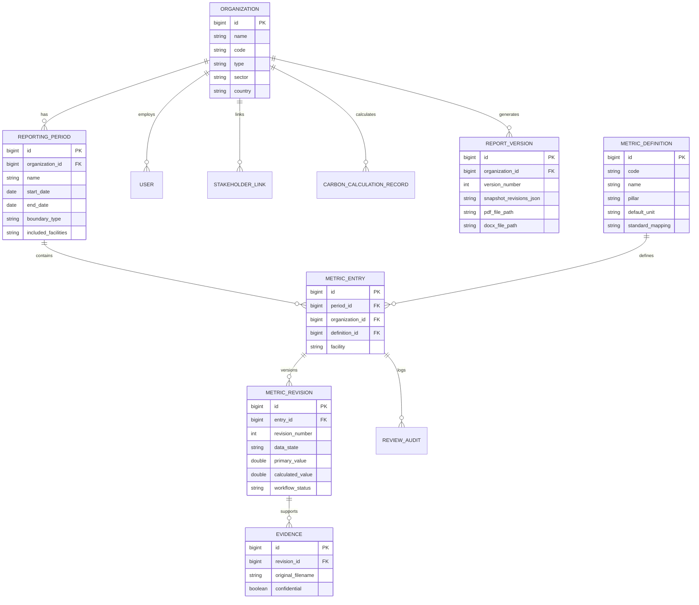

# ESG Reporting Module & Carbon Integration: Application Working Document & Design Note

**Document Version:** 1.0.0  
**Project:** Java Full Stack Developer Intern Assignment  
**Example Organization:** Apex Global Manufacturing Ltd (`APEX-MFG`)  
**Reporting Period:** FY 2025–2026 (April 1, 2025 – March 31, 2026)  
**Reporting Boundary:** Operational Control (HQ Pune, Plant 1 Bhosari, Plant 2 Chakan)  

---

> [!IMPORTANT]
> **Internal ESG Reporting Prototype Disclaimer:**  
> This application is an internal engineering prototype designed for evidence-based review workflows and multi-stakeholder GHG integration. Inclusion of metric definitions mapped to GRI (Global Reporting Initiative) Standards or the GHG Protocol Corporate Standard serves alignment and educational purposes only. It does not constitute formal statutory audit compliance, nor does it certify full legal adherence to CSRD, BRSR, or SEC climate disclosures without external third-party limited or reasonable assurance.

---

## 1. ESG Understanding & Contextual Examples

### 1.1 Environmental, Social, and Governance in Plain Language
- **Environmental (E):** Measures an organization’s stewardship over natural resources, greenhouse gas atmospheric impact, energy transition, water preservation, and circular material recovery.  
- **Social (S):** Evaluates an enterprise's relationships with human beings—its direct employees, contractors, supply chain laborers, and surrounding communities. Key focus areas include employee retention, health and safety incident prevention, and continuous professional training.  
- **Governance (G):** Details internal corporate accountability, ethical oversight, decision-making integrity, and executive compliance controls. Key focus areas include independent board oversight, anti-bribery policies, and whistleblower protections.

### 1.2 Value Chain ESG Examples
| Value Chain Segment | Environmental (E) Example | Social (S) Example | Governance (G) Example |
| :--- | :--- | :--- | :--- |
| **Suppliers** | Scrap steel recycling rate and smelting kiln energy intensity. | Verified prohibition of child labor and fair living wage compliance. | Anti-bribery screening and conflict minerals provenance certification. |
| **Manufacturing** | Stationary combustion boiler fuel efficiency and zero liquid discharge (ZLD). | OSHA lost-time injury incident tracking and ergonomic safety training. | Independent board safety committee and whistleblower grievance logging. |
| **Logistics** | Fleet fuel efficiency and transition to EV / Euro-VI distribution vehicles. | Long-haul driver maximum shift rest hours and safety fatigue monitoring. | Anti-kickback customs compliance and freight subcontractor audit screening. |
| **Distribution** | Cold-storage low-GWP refrigerant management and warehouse solar PPAs. | Material handling equipment operator certifications and accident protocols. | Chain of custody temperature tracking and non-counterfeit validation. |
| **Wholesale** | Bulk packaging scrap circularity and pallet wooden re-use systems. | Fair contractual treatment of regional wholesale trade partners. | Anti-monopolistic fair trade terms and transparent rebate structures. |
| **Retail** | In-store energy smart HVAC controls and packaging take-back recycling. | Retail associate fair scheduling and harassment-free workplace training. | Consumer data privacy and ethical advertising disclosures. |

---

## 2. Why Carbon Reporting Alone Does Not Cover ESG

While greenhouse gas (GHG) accounting evaluates climate warming impact ($CO_2e$), climate indicators alone do not determine whether a company is ethically managed or socially responsible:
1. **Blindness to Human Capital:** A manufacturing facility could possess solar-powered equipment (low Scope 2 GHG) while simultaneously maintaining hazardous factory working conditions, excessive turnover, or abusive contractor labor.
2. **Blindness to Fiduciary & Ethical Malfeasance:** An enterprise could meet corporate decarbonization targets while senior executives engage in bribery, insider trading, or board-level conflicts of interest.
3. **Resource Interdependencies:** Carbon calculations do not assess watershed depletion. An industrial site in a critically water-stressed region could have modest energy emissions while extracting unsustainable groundwater volumes, imperiling local communities.

ESG reporting unites operational climate disclosures with human welfare and governance integrity to provide a balanced evaluation of enterprise resilience.

---

## 3. Reporting Boundary, Inventory vs. Product Footprints, and Data States

### 3.1 Organization GHG Inventory vs. Product Carbon Footprint (PCF)
- **Organization GHG Inventory (GHG Protocol Corporate Standard):** Quantifies total direct and indirect emissions generated across the enterprise's defined operational control boundary over a specific 12-month period (Scope 1 direct fossil fuels, Scope 2 electricity, Scope 3 value chain categories).
- **Product Carbon Footprint (PCF / ISO 14067):** Quantifies cumulative life-cycle emissions attributable to a single functional unit of product (e.g., 1 kg of machined automotive shaft) from cradle-to-gate.
- **Rule Enforced in Application:** *A cumulative product footprint is not substituted as an organization inventory, and supplier emissions are not double-counted.*

### 3.2 Verified Data vs. Model Estimates
- **Verified / Measured Data:** Derived from calibrated physical measuring equipment (MIDC utility invoices, smart electricity meters, weighbridge scrap manifests, HR census records).
- **Model Estimates:** Derived from secondary industry benchmarks, supplier averages, or spend-based economic input-output multipliers.
- **Data State Flags Supported:**
  - `PROVIDED`: Primary measured empirical data.
  - `ESTIMATED`: Calculated using benchmark intensity or modeling assumptions.
  - `UNAVAILABLE`: Data omitted; requires explicit mandatory justification reason.
  - `NOT_APPLICABLE`: Indicator not applicable to the operating model; requires reason.

---

## 4. Required ESG Metrics Master Specification

| Metric Code | Indicator Name | Pillar | Why It Matters | Formula / Calculation | Data Source | Boundary | Owner / Reviewer |
| :--- | :--- | :--- | :--- | :--- | :--- | :--- | :--- |
| `ENV_SCOPE1_EMISSIONS` | Scope 1 Direct GHG | E | Direct operational emissions from owned boilers/gensets. | $\text{Fuel (Litres)} \times 2.68\text{ kg CO}_2\text{e/L}$ | Delivery receipts | Operational Control | Plant EHS / CSO |
| `ENV_SCOPE2_LOCATION` | Scope 2 (Location-Based) | E | Physical grid average GHG intensity of operations. | $\text{Grid kWh} \times 0.713\text{ kg/kWh}$ | Utility Bills | Operational Control | Energy Lead / CSO |
| `ENV_SCOPE2_MARKET` | Scope 2 (Market-Based) | E | Reflects contractual green PPAs and renewable instruments. | $\text{Contractual Tariffs Factor}$ | Solar PPA Invoices | Operational Control | Energy Lead / CSO |
| `ENV_SCOPE3_EMISSIONS` | Scope 3 Value Chain GHG | E | Upstream/downstream value chain emissions (Cat 1, 4, 6). | GHG Scope 3 Protocol Activity Data | Supply chain records | Value Chain | Supply Lead / CSO |
| `ENV_ENERGY_CONSUMPTION`| Total Energy by Source | E | Standardizes fuel and electricity into common unit. | $\text{kWh} + (\text{Litres Diesel} \times 10.0\text{ kWh/L})$ | Meters & Fuel Logs | All Facilities | Facility Lead / CSO |
| `ENV_WATER_WITHDRAWAL` | Water Withdrawal | E | Monitors watershed withdrawal (labeled as withdrawal). | Flow meter volume ($m^3$) | Utility Meters | All Facilities | Facility Lead / CSO |
| `ENV_WASTE_RECYCLING` | Waste Recycling Rate | E | Circular byproduct diversion from municipal landfill. | $\frac{\text{Recycled Mass}}{\text{Total Waste Mass}} \times 100$ | Weighbridge Manifests | All Facilities | EHS Officer / CSO |
| `SOC_WORKFORCE_TURNOVER`| Workforce Turnover % | S | Human capital retention and operational stability. | $\frac{\text{Departures}}{(\text{Start} + \text{End})/2} \times 100$ | HR Census | Direct Payroll Only | HR Director / CSO |
| `SOC_EMPLOYEE_TRAINING` | Training Intensity | S | Workforce upskilling, technical, and safety competence. | $\frac{\text{Total Hours}}{\text{Documented Average Headcount}}$ | LMS Logs | Direct Payroll Only | HR Director / CSO |
| `SOC_WORKPLACE_SAFETY` | Workplace Injury Rate | S | Worker occupational health and hazard prevention. | Incidents count; LTIFR per 1,000,000 hrs | OSHA Register | Manufacturing Plants| Safety Head / CSO |
| `GOV_BOARD_COMPOSITION` | Board Independence | G | Fiduciary oversight, preventing executive conflicts. | $\frac{\text{Independent Members}}{\text{Total Members}} \times 100$ | Secretarial Filings | Governing Board | Co. Secretary / Board |
| `GOV_ANTI_CORRUPTION` | Anti-Bribery Training | G | FCPA/Bribery Act compliance and ethical culture. | $\frac{\text{Trained Unique People}}{\text{Eligible Population}} \times 100$ | LMS Compliance Logs | Eligible Staff | Legal Counsel / CSO |
| `GOV_ETHICS_REPORTING` | Whistleblower Cases | G | Evaluates speak-up culture and resolution efficacy. | Total cases (open vs closed; privacy protected) | Ethics Hotline Log | Entire Enterprise | Audit Committee |

---

## 5. Workflow Governance & Separation of Duties

### 5.1 Review State Machine
```
[DRAFT] ──────── (Contributor Submits) ────────> [SUBMITTED]
   ^                                                   │
   │                                           Reviewer Evaluates
   │                                                   │
   ├── (Reviewer Requests Changes with Comment) ───────┤
   │                                                   ▼
[NEW REVISION (DRAFT)]                            [APPROVED]
```

### 5.2 Mandatory Security Rules Enforced in Backend
1. **Separation of Duties:** Contributors **cannot** approve their own submissions (`actor_id != submitted_by_id`).
2. **Immutable Audit Trail:** Approved revisions are never silently overwritten; edits trigger revision increments ($v_1 \to v_2$) while preserving earlier evidence and reviewer timestamps.
3. **Cross-Organization Isolation:** Users belonging to a supplier organization (e.g. GreenSteel) are forbidden from querying or mutating reporting company data.
4. **Supplier Workforce Segregation:** Supplier headcounts are maintained strictly in distinct records and are **not summed** into the reporting company's workforce.

---

## 6. System Architecture & ER Diagram

### 6.1 Technology Stack
- **Backend:** Java 25 LTS, Spring Boot 3.3.4, Spring Security (Stateless JWT), Spring Data JPA, OpenPDF (1.3.40), Apache POI (5.2.5), springdoc-openapi (2.6.0).
- **Frontend:** React 19, Vite 8, Tailwind CSS v4, Lucide Icons, Axios.
- **Database:** MySQL 8.0 (`esg_reporting_db`).

### 6.2 Entity-Relationship (ER) Diagram


---

## 7. Demo Credentials for Evaluation

| Role | Username | Password | Organization | Description |
| :--- | :--- | :--- | :--- | :--- |
| **Administrator** | `admin` | `admin123` | Apex Global Mfg | Global admin with period and definition permissions |
| **Contributor** | `contributor` | `contrib123` | Apex Global Mfg | Reporting company data contributor (Priya Sharma) |
| **Reviewer** | `reviewer` | `review123` | Apex Global Mfg | Chief Sustainability Officer / Reviewer (Vikram Mehta) |
| **Supplier User** | `supplier_user` | `supplier123` | GreenSteel Supply | Tier-1 Supplier Contributor (Rahul Verma) |
| **Report Viewer** | `auditor` | `viewer123` | Global Assurance | External Auditor (Elena Rostova, read-only approved data) |

---

## 8. Deployment and Verification Steps

### 8.1 Backend Execution
```powershell
cd "d:\Coding\Java Project\backend"
.\mvnw.cmd test                  # Runs 16 unit and acceptance tests
java -jar target\esg-reporting-backend-1.0.0.jar  # Starts on port 8088
```
- **Swagger UI:** `http://localhost:8088/swagger-ui/index.html`
- **OpenAPI JSON:** `http://localhost:8088/v3/api-docs`

### 8.2 Frontend Execution
```powershell
cd "d:\Coding\Java Project\frontend"
npm install
npm run dev                      # Starts on http://localhost:3000
```

### 8.3 Generated Sample Report
- Sample immutable approved ESG report generated in PDF: `docs/sample_esg_report.pdf`
- Word format: `backend/reports/ESG_Report_Org1_P1_v1.docx`
